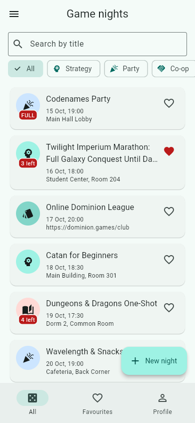
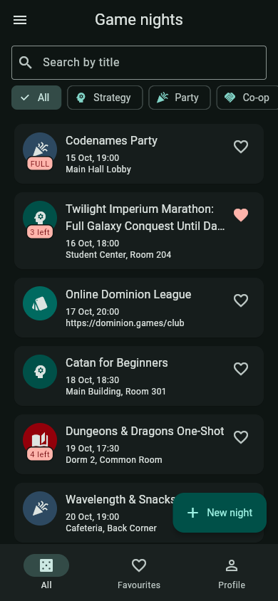
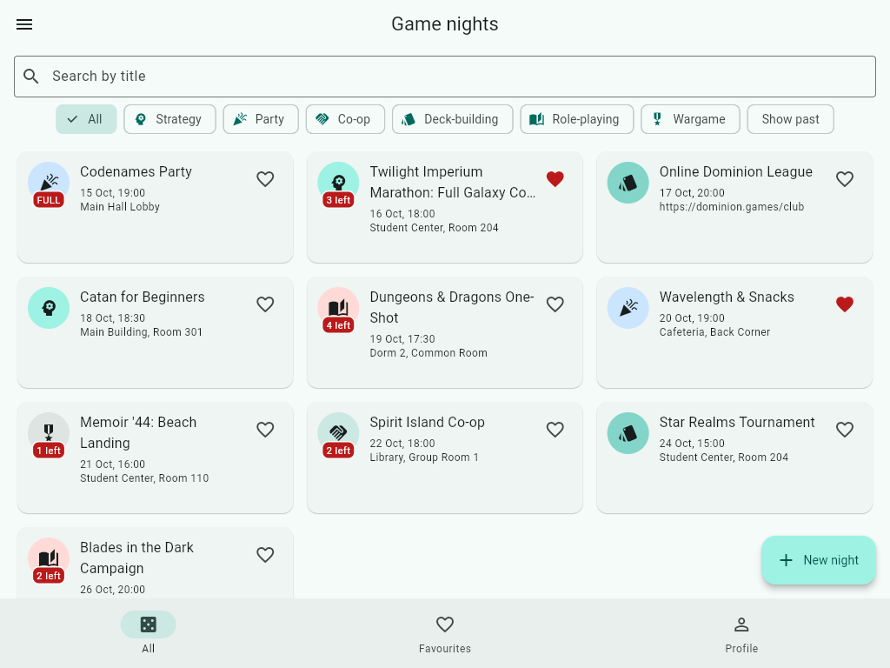

# Game Nights — Lab 1

**Domain:** board game nights at the campus club. Each night has a title, a genre
(strategy, party, co-op, deck-building, role-playing, wargame), a start time, a
venue, a number of seats and a list of players. **Join** puts your name on the
list, and **Leave** takes it off. An *online* night has a link instead of a room.
All data lives in memory: no network and no storage.

Run it with `flutter run` (or `flutter run -d chrome`).

| Phone, light | Phone, dark | Tablet grid |
|---|---|---|
|  |  |  |

## Decisions

The list of nights and the profile live in the shell's `State` (`lib/shell.dart`),
which is the lowest widget above every screen that reads or changes them. Tabs get
them through their constructors and send changes back up through callbacks. The
detail screen takes callbacks because the shell owns the list: it changes the
list through `onChanged` / `onDelete` and keeps a local copy only so it can
redraw. The form only creates a value and has nothing to change, so it returns
the night through `pop` and the caller decides what to do with it. The grid is
chosen by a `LayoutBuilder` because the decision depends on the space this widget
was given, not on the whole screen (`MediaQuery`). That still holds if the list
ever sits beside a side panel. `PopScope` compares the current field values with
the ones the form opened with (`_dirty`), so a clean form pops freely and only a
dirty one asks "Discard changes?". With week 9's tools I would move the list out
of the shell into a shared store, such as a `ChangeNotifier` with an
`InheritedNotifier` or a state-management package, and persist it. Then the
detail screen could watch the night by id instead of keeping a copy, and the
callbacks would go away.

**Colour seed:** R22 forbids literal colours in `lib/`, but `ColorScheme.fromSeed`
needs one `Color`. The seed `Colors.teal` appears exactly once, in `main.dart`,
and the course starters do the same. Every other colour is a `colorScheme` role,
and every text style is a `textTheme` role.

## Requirement map

| R | Where |
|---|---|
| R1–R5, R7 sort | `lib/models/game_night.dart`, `lib/models/profile.dart` |
| R6 | `_AboutTab` in `lib/screens/detail_screen.dart` (`if (night.notes case final notes?)`) |
| R8 | `lib/utils/format.dart` |
| R9 | `lib/models/countdown.dart`, `_Header` in `detail_screen.dart` |
| R10, R12, R28, R32 | `lib/shell.dart` |
| R11, R22 | `lib/main.dart`, theme chips in `lib/tabs/profile_tab.dart` |
| R13, R15, R16, R24, R29, R31 | `lib/screens/detail_screen.dart` |
| R14, R17, R30, R33–R37 | `lib/screens/form_screen.dart` |
| R18, R19 | `lib/widgets/night_card.dart` |
| R20 | `lib/widgets/night_collection.dart` |
| R21 | `lib/tabs/list_tab.dart` |
| R23 | `lib/widgets/empty_state.dart` (used by list, favourites and players tabs) |
| R25, R26 | `lib/routes.dart` |
| R27 | `_create` in `shell.dart`, `_edit` in `detail_screen.dart` |
| R38 | `lib/tabs/profile_tab.dart` |
| Seed (12 nights, 5 mandatory) | `lib/data/seed.dart` |

Code that meets a requirement has a matching `// R##` comment next to it.

## Defence pool cheat-sheet

1. **Sixth genre.** Add a value to `GameGenre` in `game_night.dart`, for example
   `family('Family', Icons.family_restroom)`. The compiler then points at the
   `color()` switch, which needs a new arm. The chips, the dropdown and the
   avatars all loop over `GameGenre.values`, so they update themselves.
2. **Sort by title, past still last.** In `compareByDate`, change the last
   branch to `a.title.toLowerCase().compareTo(b.title.toLowerCase())`, or add a
   `compareByTitle` and use it in `list_tab.dart`.
3. **Search by place too.** In `list_tab.dart`, `where`: write
   `(n.title.toLowerCase().contains(query) || n.venue.toLowerCase().contains(query))`.
4. **Online-only FilterChip.** Add `bool _onlineOnly = false;` in `_ListTabState`
   and a second `FilterChip` in the row. Then add `&& (!_onlineOnly || n.online)`
   to the `where`.
5. **Favourites badge.** In `shell.dart`, wrap the favourites destination's icons
   in `Badge(label: Text('$count'), isLabelVisible: count > 0, child: ...)`, with
   `count = _nights.where((n) => n.favourite).length`. Remove `const` from the
   list.
6. **Grid at 720 px, max 3 columns.** In `night_collection.dart`, use `>= 720`.
   Change the delegate to `SliverGridDelegateWithFixedCrossAxisCount(crossAxisCount: min(3, (constraints.maxWidth / 360).ceil()), mainAxisExtent: 136)`,
   which needs `dart:math`.
7. **Confirm before Leave.** Make `_leave` async in `detail_screen.dart`, call
   `confirm(context, title: 'Leave ...?', ...)`, then check `if (ok != true || !mounted) return;`.
8. **"Started N minutes ago" for the first hour.** In `_Header`, change the arm to
   `Started(:final ago) => ago.inMinutes < 60 ? 'Started ${ago.inMinutes} minutes ago' : 'In progress'`.
9. **Duplicate.** Add `_MenuAction.duplicate` (the compiler flags the switch) and a
   `PopupMenuItem` for it. `_duplicate()` should push `Routes.form` with
   `FormArgs(night: copy)`. To build the copy, add an `id` parameter to
   `copyWith` or build a `GameNight` with a new id, title `'${t} (copy)'` and
   `players: const []`. On return, call `onChanged`. The shell's `_replace` only
   swaps an existing id, so add an `onAdd` callback to `DetailArgs`.
10. **Mode-dependent seat limit.** In `form_screen.dart` `_validateSeats`, add
    `if (_online && seats > 100) return 'Online nights have at most 100 seats';`.
11. **Statistics tile.** Add a drawer `ListTile` in `shell.dart` that opens an
    `AlertDialog`. Its content is a `Column` built from
    `for (final g in GameGenre.values) Text('${g.label}: ${_nights.where((n) => n.genre == g).length}')`,
    or from a `fold` into a `Map`.
12. **Clear profile.** In `profile_tab.dart`, add a `TextButton('Clear')`. Its
    handler awaits `confirm(...)`, checks `mounted`, then calls
    `widget.onProfileChanged(const Profile.empty())`. `didUpdateWidget` already
    resets the fields.
13. **Empty-search button resets everything.** In `_clearSearch` in
    `list_tab.dart`, also set `_genre = null` and `_showPast = false` inside the
    same `setState`.
14. **Past toggle in the AppBar.** The `AppBar` is in `shell.dart`, so move
    `_showPast` up to the shell and pass it down to `ListTab` as a parameter.
    Add an `IconButton(icon: Icon(_showPast ? Icons.history_toggle_off : Icons.history), onPressed: () => setState(() => _showPast = !_showPast))`
    to the shell's `actions` when `_tab == 0`, and remove the `FilterChip`.
15. **Notes as a second subtitle line.** In `night_card.dart`, add
    `if (night.notes case final notes?) Text(notes, maxLines: 2, overflow: TextOverflow.ellipsis, style: text.bodySmall)`
    to the column. Raise the grid `mainAxisExtent`, for example to 172.
16. **"You" first, in bold.** In `_PlayersTab`, build
    `final ordered = [...players.where((p) => p == you), ...players.where((p) => p != you)]`.
    Use `style: isYou ? const TextStyle(fontWeight: FontWeight.bold) : null`.
