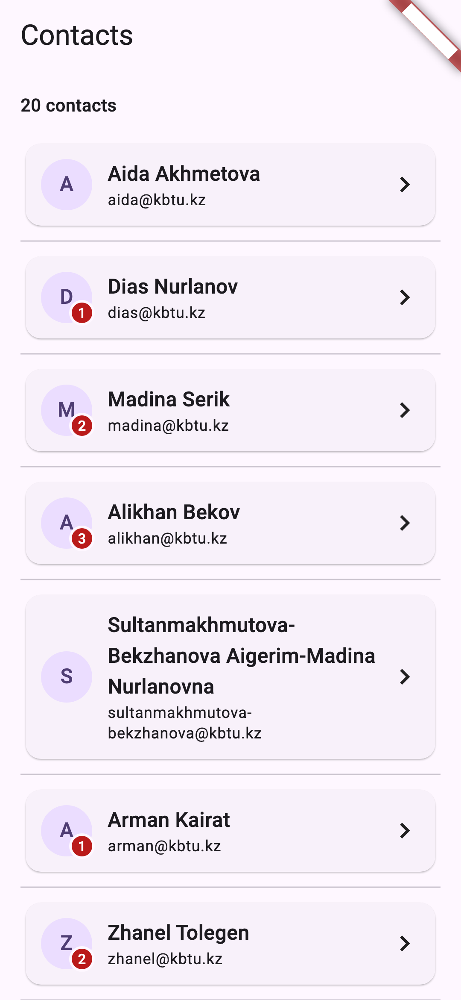
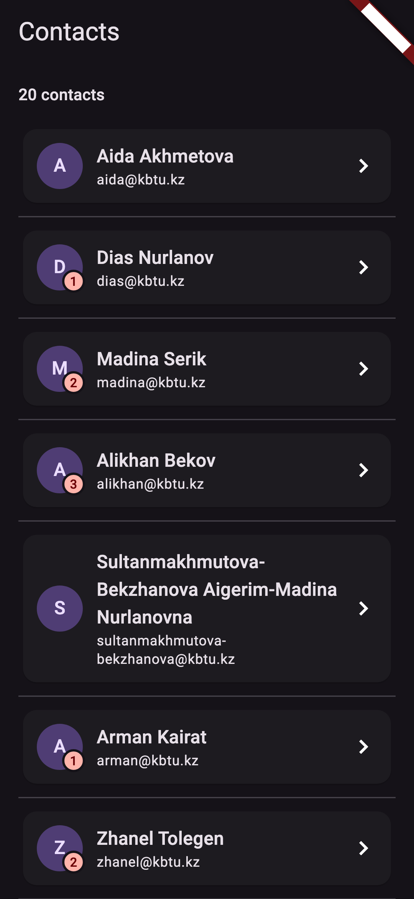
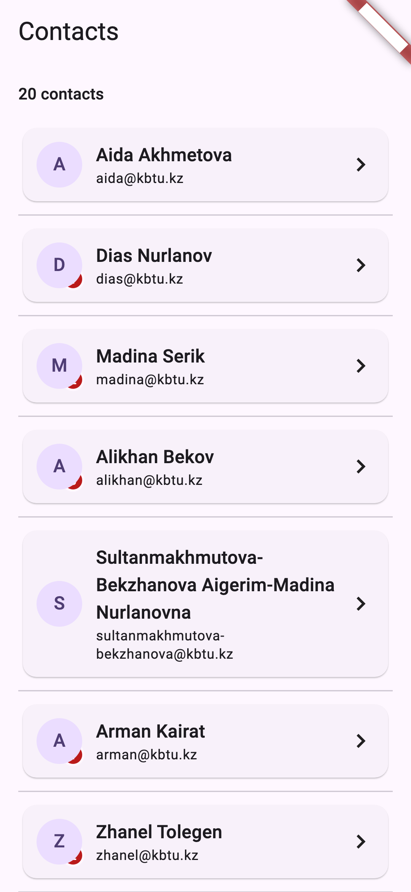

# Practice 5 — A Screen That Never Overflows

`flutter run` · `flutter analyze` → No issues found!

- `lib/contact_card.dart`: Row → Stack avatar with Positioned badge (collection-if) · Expanded Column · chevron
- `lib/contact_list.dart`: header Text + `Expanded(ListView.separated)`
- `lib/main.dart`: one seed, `theme` + `darkTheme`, `ThemeMode.system`

| Light | Dark | Stack swapped |
|---|---|---|
|  |  |  |
