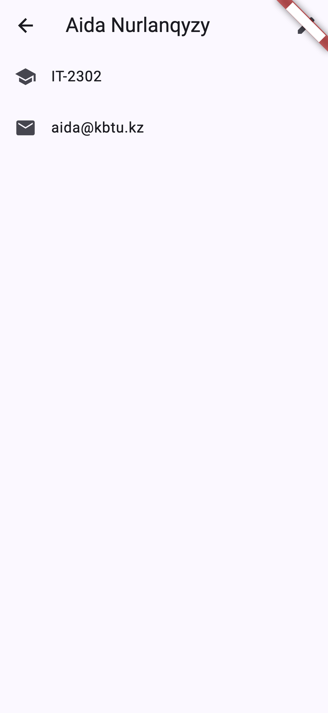
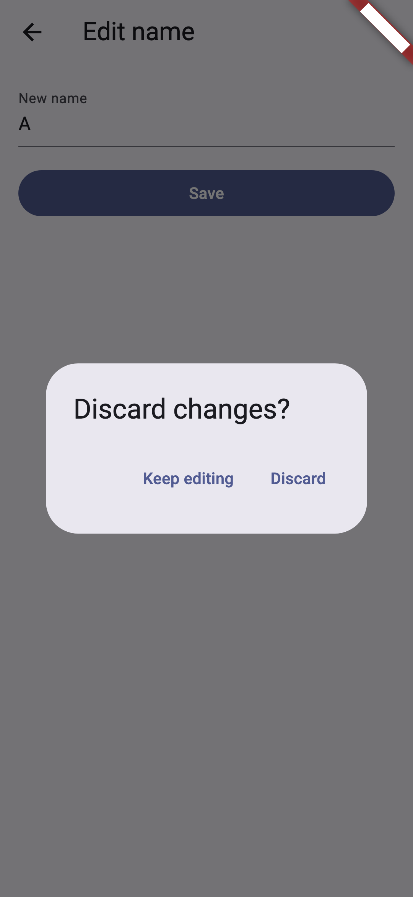

# Practice 6 — Screens That Lead to Screens

`flutter run` · `flutter analyze` → No issues found!

- `lib/routes.dart`: route names; `lib/main.dart`: `routes:` for the list, `onGenerateRoute` for detail/edit
- `lib/detail_screen.dart`: `await pushNamed<String>` → null + mounted check → `setState`
- `lib/edit_screen.dart`: `pop(_name)`; `PopScope(canPop: !_dirty)` asks "Discard changes?"

| Detail (edited) | Discard dialog |
|---|---|
|  |  |
